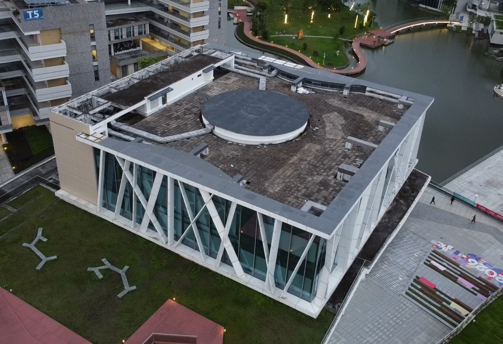
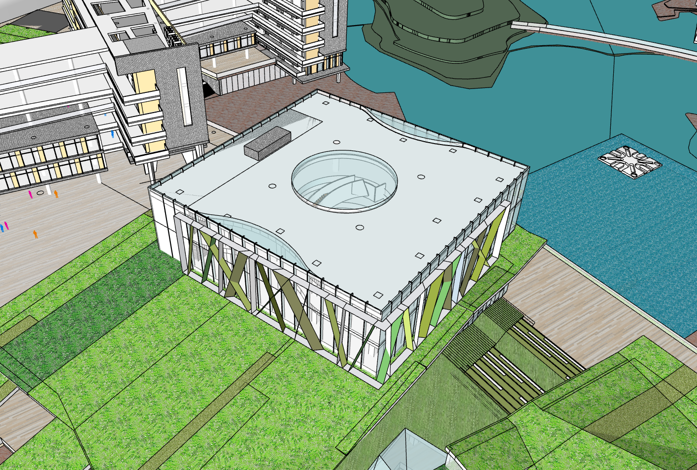
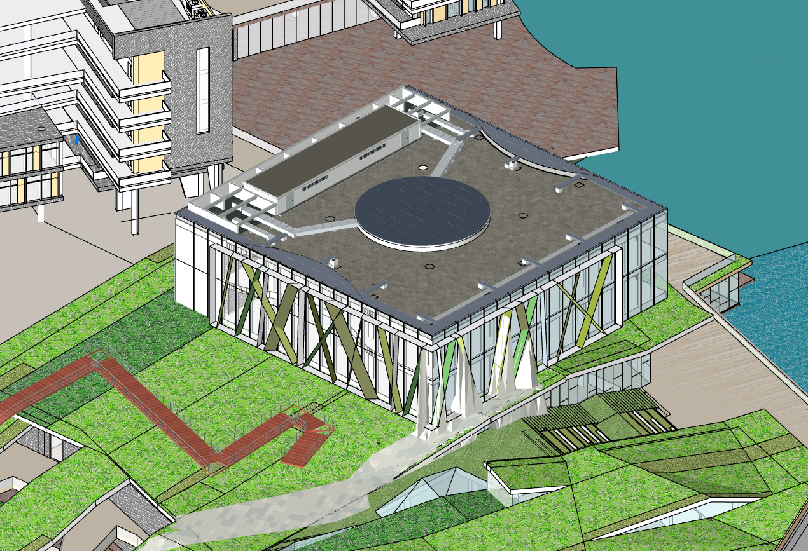
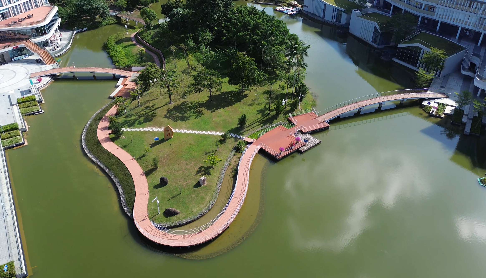
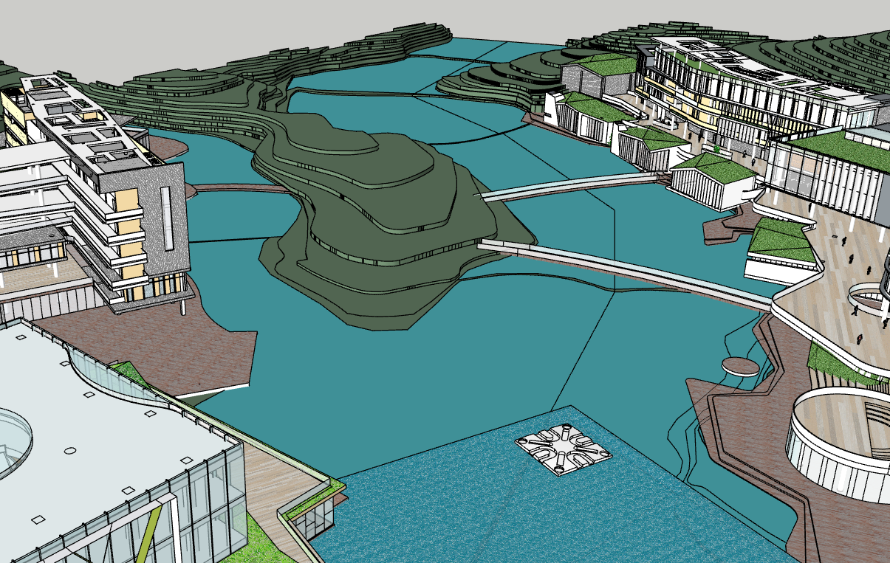
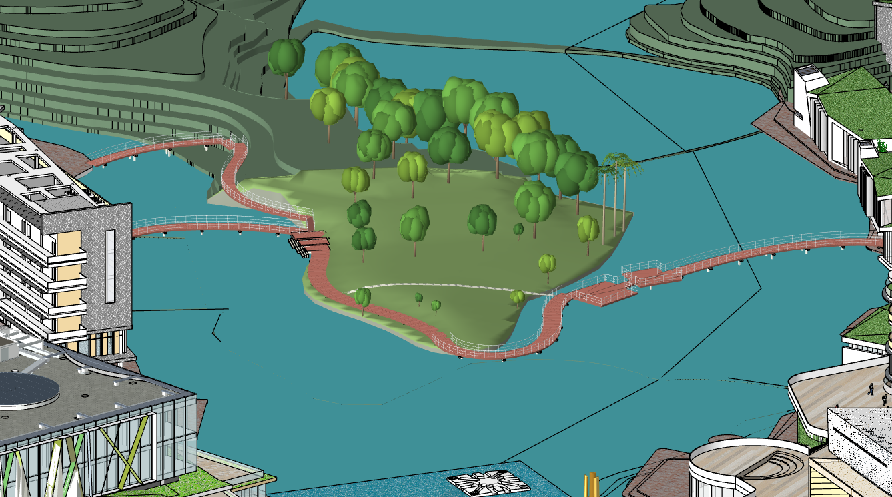
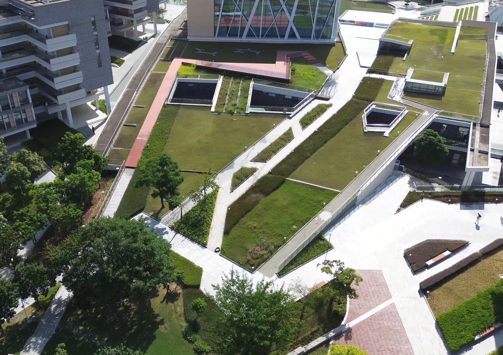
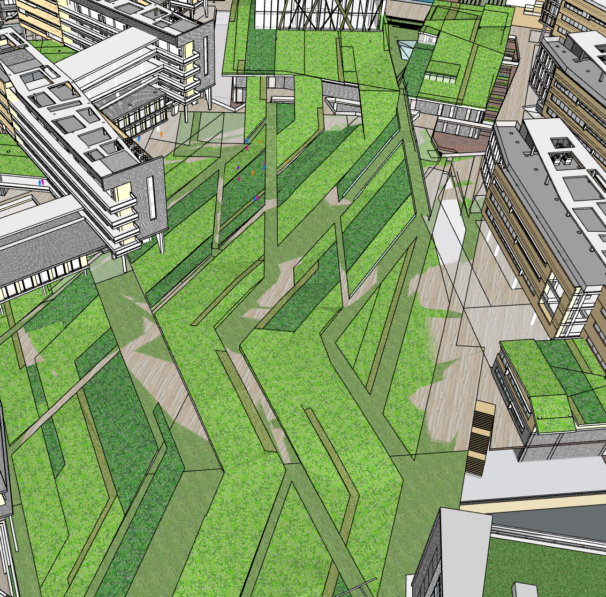
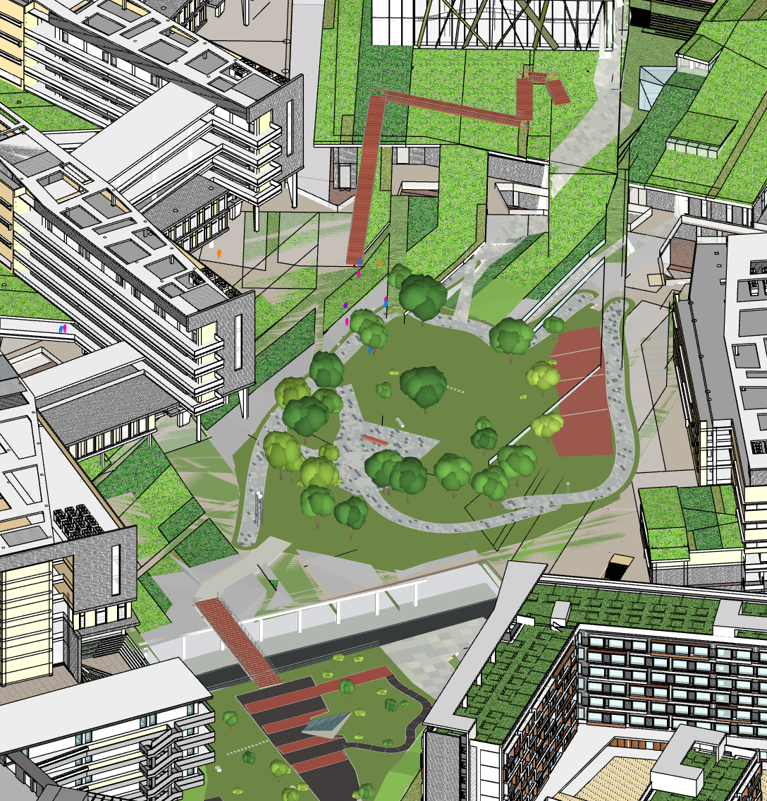

# Zip2CAD 1.0 Showcase

Neural-assisted CAD revision from real-world observations, with a five-command demonstration using pretrained models.

Zip2CAD combines video reconstruction, CAD registration, optional neural task heads, and engineering geometry constraints. It produces editable SketchUp candidates that preserve the original model, change records, and evaluation reports. This edition retains the research code and adds an interactive library-roof demonstration that requires no live training.

## Showcase Quick Start

Use Python 3.11. Download the source and `Zip2CAD1.0-Showcase-library-demo.zip` from the project's GitHub Release. Extract the source, then extract the demo data into the project root. Confirm that this file exists without an extra nested directory:

```text
artifacts/showcase/library/manifest.json
```

Install the environment from the project root:

```powershell
python -m venv .venv
.venv\Scripts\python -m pip install -e ".[neural]"
```

Double-click `START_SHOWCASE_CLI.cmd`, then enter each command separately:

```text
python step1.py
python step2.py
python step3.py
python step4.py
python step5.py
```

| Command | Purpose |
|---|---|
| `python step1.py` | Validate observation inputs, coordinate contracts, and pretrained checkpoints; create a new run directory. |
| `python step2.py` | Run fresh geometry and six-corner inference from saved observations and write prediction JSON files. |
| `python step3.py` | Export OBJ geometry and a prediction image; write and reload a predicted SKP when the official SketchUp SDK is available. |
| `python step4.py` | Verify and copy the prepared full-campus deliverable. |
| `python step5.py` | Verify earlier outputs, write the run report, and display the output-folder menu. |

Each command returns to the terminal when finished. The next step starts only when you enter its command. After step 5, enter **0** and press Enter to open the output folder. The CLI uses English and does not open a browser automatically.

### Outputs and Execution Scope

- `live_predicted_library.skp`: the library model generated from the current inference run, when the SketchUp SDK is available.
- `campus_final_showcase.skp`: the prepared complete campus model, copied and verified for final presentation.
- Prediction JSON files, OBJ geometry, a prediction image, per-step logs, and a run report with input and checkpoint hashes.

**Fresh task-head predictions and the prepared full-campus deliverable are separate outputs.** The complete campus is not generated live by the two heads. The demonstration starts from saved observations and precomputed features; it does not train models, reconstruct the full video, or extract Sonata features during the presentation. The current heads were developed on the same library case and do not establish generalization to independent buildings.

CPU inference is supported; CUDA and the ZipMap/Sonata backbones are not required for this prepared demonstration. Native predicted SKP export requires the official SketchUp C SDK. The program checks for an installed SketchUp application automatically; alternatively, configure `ZIP2CAD_SKETCHUP_SDK`. Without the SDK, inference, OBJ, images, logs, and the prepared campus deliverable remain available. Use `python step1.py --skp required` to require native SKP export, or `--skp off` to disable it.

After completing all five steps, run `python step1.py` to start another demonstration. To start a new run before the current one is complete, use `python step1.py --new-run`. Existing output directories are preserved. Earlier inputs and outputs are checked between steps to prevent continuation with changed data.

The optional browser workbench is available through `START_SHOWCASE.cmd`. It provides local file inputs, inference logs, source inspection, and geometry previews. Additional operating notes are in [the Showcase guide](docs/SHOWCASE.md).

## Revision Examples

Read each comparison from left to right: real-world photograph, original SKP, revised SKP. Click an image to view it at full size. These nine author-supplied images retain their original content and aspect ratios; some viewpoints and framing differ.

### Library Roof

<table>
  <tr><th width="33%">Real-World Photograph</th><th width="33%">Original SKP</th><th width="33%">Revised SKP</th></tr>
  <tr>
    <td align="center"><a href="docs/assets/comparisons/library_scene.png"></a></td>
    <td align="center"><a href="docs/assets/comparisons/library_before.png"></a></td>
    <td align="center"><a href="docs/assets/comparisons/library_after.png"></a></td>
  </tr>
</table>

Compare the rooftop room, circular roof, ducts, and surrounding components.

### Lake Island and Boardwalk

<table>
  <tr><th width="33%">Real-World Photograph</th><th width="33%">Original SKP</th><th width="33%">Revised SKP</th></tr>
  <tr>
    <td align="center"><a href="docs/assets/comparisons/island_scene.png"></a></td>
    <td align="center"><a href="docs/assets/comparisons/island_before.png"></a></td>
    <td align="center"><a href="docs/assets/comparisons/island_after.png"></a></td>
  </tr>
</table>

Compare the island, perimeter walkway, boardwalk, and landscape elements.

### Landscape Roof and Walkway

<table>
  <tr><th width="33%">Real-World Photograph</th><th width="33%">Original SKP</th><th width="33%">Revised SKP</th></tr>
  <tr>
    <td align="center"><a href="docs/assets/comparisons/landscape_roof_scene.png"></a></td>
    <td align="center"><a href="docs/assets/comparisons/landscape_roof_before.png"></a></td>
    <td align="center"><a href="docs/assets/comparisons/landscape_roof_after.png"></a></td>
  </tr>
</table>

Compare the roof terrain, walkway, openings, and vegetation representation.

These are qualitative project-scene comparisons, not generalization evaluations on three independent buildings. The public geometry head supports one rooftop room and two ducts; these images do not establish that it can directly generate complete islands, vegetation, or landscape components. See the scope below and the [model card](models/pretrained/README.md). Campus SKP files are excluded from the Git source tree; the Showcase case and selected deliverable are distributed separately in the demo ZIP.

## Research Workflow Quick Start

Python 3.11 is recommended. Install GPU dependencies separately for training or feature extraction. Native SKP reading and writing require the official SketchUp C SDK.

```bash
python -m pip install -e '.[dev]'
python -m zip2cad doctor
python -m zip2cad steps
python -m unittest discover -s tests -v
```

### A. Exercise the Software Workflow Without Large Models

```bash
python tools/create_synthetic_workflow_fixture.py --output outputs/synthetic_fixture
python -m zip2cad run --config outputs/synthetic_fixture/project.json --output run
```

This executes all 14 software stages and saves a native SKP. The video and cached point maps are **explicitly labeled synthetic software fixtures**; they do not demonstrate ZipMap or neural prediction accuracy. A local SDK is required for this workflow. Core tests that do not require the SDK can run in GitHub Actions.

### B. Process Your Own Real-World Video

1. Configure official ZipMap code, weights, and CUDA using the [installation guide](docs/INSTALL.md).
2. Place the video and original SKP under `data/raw/`; copy `configs/project.example.json` to your own configuration file.
3. Establish at least four well-distributed 3D correspondences on stable facades, or provide a verified Sim(3) registration. Do not adjust evaluation coordinates using the roof being repaired.
4. Configure the target building's PID range. For a full-campus SKP, select the target building group first to reduce interference from other buildings.
5. Run:

```bash
python tools/setup_backbones.py zipmap --weights
python -m zip2cad run --config configs/my_project.json --output outputs/my_building
# Resume if the configuration and recorded artifacts are unchanged:
python -m zip2cad run --config configs/my_project.json --output outputs/my_building --resume
```

**The default `neural.enabled=false` explicitly selects a geometry baseline without neural inference.** Three project-specific pretrained task heads are included. To try neural enhancement, use `configs/project.pretrained.example.json` and install Sonata; see [using public models](docs/USE_PRETRAINED.md) and [training documentation](docs/TRAINING.md). Missing models are not silently reported as applied neural inference.

Outputs include `corrected_RESEARCH.skp`, `workflow.json`, `13_change_proposal.json`, `14_verification.json`, and intermediate point clouds. Insufficient evidence may result in retaining the original CAD; a successful run does not mean that every component has been repaired.

## Complete 14-Stage Workflow

| Step | Operation | Main Output |
|---|---|---|
| 01 | Validate video, CAD, and cache provenance | Input hashes |
| 02 | Extract frames, filter quality, and form overlapping blocks | Frame manifest and JPEG files |
| 03 | Run official ZipMap inference or explicitly labeled cache replay | Cameras, depth, and point maps per block |
| 04 | Align overlapping frames with Sim(3) and deduplicate fusion by physical frame | Arbitrary-scale point cloud and provenance |
| 05 | Export original CAD and roof context using the official SDK | CAD mesh, PIDs, and support surfaces |
| 06 | Register using anchors or verified Sim(3); optionally use experimental automatic initialization | Observations in CAD metric coordinates |
| 07 | Crop to the CAD extent and voxelize observations | Roof point cloud and physical-frame provenance |
| 08 | Establish a model coordinate contract without reference targets | Input normalization frame |
| 09 | Optionally extract frozen Sonata features and predict semantics | Features and nine-class probabilities |
| 10 | Optionally predict room and duct geometry using trained heads | Learned parameters and components |
| 11 | Construct parametric geometry, check closed solids, and save/reload native SKP | Editable SKP candidate |
| 12 | Evaluate only when a reference is available, with fixed coordinates and ROI | Bidirectional surface distances and precision/recall/F1 |
| 13 | Record recommendations to retain or extend original CAD and generate a run page | Change proposal |
| 14 | Verify original-input protection and result integrity | Final verification and progress records |

Training is a separate workflow performed before inference, with `train-semantic`, `train-joint`, and `train-corners` commands. Processing a video does not automatically start a long training run. See the [workflow guide](docs/WORKFLOW.md).

## Library 1.0 Research Case

The author's local research bundle is organized under `artifacts/library1.0/`: the original project, M1/M2, complete reference, weights, training inputs, reports, and a research-source snapshot. This directory is excluded from Git to keep campus video, CAD, and large files outside the source repository. It is distinct from the smaller Showcase demo bundle.

```bash
python -m pip install -e '.[neural]'
python -m zip2cad library-replay --case artifacts/library1.0 --output outputs/library1.0_replay
```

This reruns trained room/duct and six-corner inference, then reconstructs the final photo-constrained components through the SDK. Later stages explicitly replay a saved algorithmic geometry plan; they are **not described as rerunning all photo optimization from video**. For new videos, use the `run` workflow rather than applying this single-building case's dimensions and labels directly.

Beam cross-section, line, multiview-mask, and column-extension procedures are also parameterized as an [executable library-detail research workflow](docs/LIBRARY_DETAILS.md), allowing recomputation rather than retaining only a final SKP.

The three trained heads in `models/pretrained/` are available for experimentation and fine-tuning on new buildings. Original campus training data are excluded from the source repository. See [using public models](docs/USE_PRETRAINED.md) and the [data documentation](docs/DATA.md).

## Known Scope and Limitations

- The learned geometry head has a fixed topology: one rooftop room and two ducts, each with three nodes. The six-corner head is a separate local branch, not a general building-generation model.
- Image cross-section, mask-consensus, and continuous-geometry algorithms are retained in modules such as `roof_multiview_lines.py`, `roof_mask_surface.py`, and `roof_image_sections.py`. Case-specific selection and correction have not been claimed as fully automatic on new buildings.
- The library reference was used in parts of training, so evaluation represents a development experiment on the same building. The historical 82.29% surface-distance reduction and 21.78 percentage-point increase in F1@0.25m compare a hybrid workflow; they are not independent real-world ground-truth accuracy measurements.
- Gaussian/3DGS methods are not included in this release's public execution entry points.

## Distribution

Publish the source and public task heads in the repository, and attach `Zip2CAD1.0-Showcase-library-demo.zip` to the same GitHub Release. The demo ZIP contains prepared observations, the original library SKP, and the selected complete campus deliverable. Visitors must extract it into the project root before running the Showcase.

Local environments, generated outputs, campus CAD files, and third-party SDK binaries are excluded from Git. `tools/make_public_archive.py` creates a source archive using Git's ignore rules. The [publishing guide](docs/GITHUB_PUBLISH.md) and [distribution notes](docs/PUBLISH.md) explain source, model, data, and SDK separation.

The project code is licensed under MIT. ZipMap, Sonata, MobileSAM, and the official SketchUp SDK retain their respective licenses; see [third-party notices](THIRD_PARTY.md).
